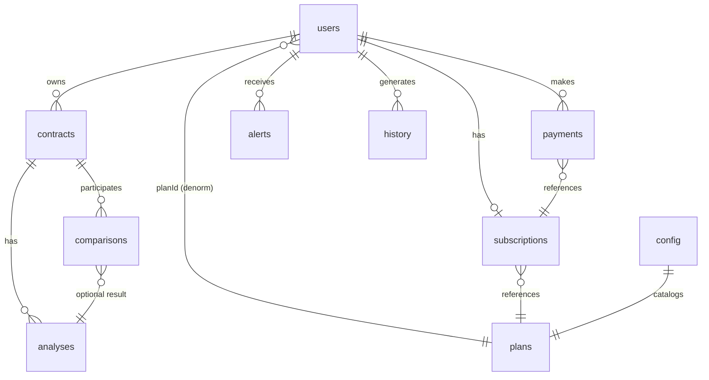
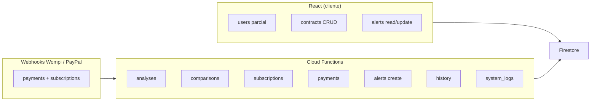
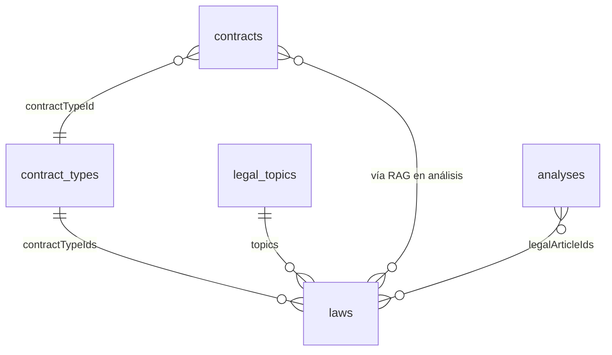

# Clausum — Modelo de datos Firestore

Diseño para escalar a **millones de documentos** con consultas eficientes, seguridad multi-tenant y separación entre datos de usuario y datos sensibles del sistema.

---

## Principios de diseño

| Principio | Aplicación |
|-----------|------------|
| **Multi-tenant por `userId`** | Toda query de usuario filtra por `userId == auth.uid` |
| **Documentos pequeños** | Máx ~100 KB por doc; resultados IA pesados en Storage o sub-docs |
| **Escritura sensible vía Functions** | Pagos, análisis IA, logs de sistema: Admin SDK only |
| **Denormalización controlada** | Copiar `plan`, `email` donde acelera lecturas; sincronizar con Functions |
| **Subcolecciones para datos ilimitados** | Historial, logs de usuario bajo `users/{uid}/...` |
| **Paginación obligatoria** | `limit(20)` + `startAfter`; nunca leer colecciones enteras |
| **TTL en datos efímeros** | Logs y eventos con política de retención (30–90 días) |
| **Contadores shardados** | Uso mensual en docs separados para evitar hot documents |

---

## Diagrama de relaciones



---

## Colecciones raíz (overview)

| Colección | Doc ID | Volumen estimado | Escritura cliente |
|-----------|--------|------------------|-------------------|
| `users` | `auth.uid` | 1 por usuario | Lectura/escritura parcial |
| `plans` | `free`, `pro`, … | < 10 docs | Solo lectura |
| `subscriptions` | auto | 1 activa + histórico por usuario | Solo lectura |
| `contracts` | auto | Millones | CRUD propio |
| `analyses` | auto | Millones | Solo lectura |
| `comparisons` | auto | Cientos de miles | Solo lectura |
| `alerts` | auto | Millones | Lectura + marcar leída |
| `payments` | auto / id proveedor | Millones | Solo lectura |
| `config` | `app`, `features`, … | < 20 docs | Solo lectura |
| `system_logs` | auto | Millones (TTL) | Sin acceso cliente |

**Historial** → subcolección `users/{uid}/history` (no raíz).

---

## 1. `users`

Perfil y estado del usuario. **1 documento por usuario.**

### Campos

| Campo | Tipo | Requerido | Descripción |
|-------|------|-----------|-------------|
| `email` | `string` | ✅ | Email de Auth |
| `displayName` | `string` | | Nombre visible |
| `photoURL` | `string` | | Avatar |
| `planId` | `string` | ✅ | `free` \| `pro` — denormalizado desde subscription |
| `locale` | `string` | | `es` \| `en` |
| `billingRegion` | `string` | | `CO` \| `LATAM` |
| `onboardingCompleted` | `boolean` | | Tutorial visto |
| `subscriptionId` | `string` | | Ref a subscription activa |
| `subscriptionStatus` | `string` | | `active` \| `canceled` \| `past_due` \| `trialing` |
| `currentPeriodEnd` | `timestamp` | | Fin del periodo pagado |
| `billingProvider` | `string` | | `wompi` \| `paypal` |
| `wompiPaymentSourceId` | `number` | | Fuente de pago Wompi (recurrente) |
| `wompiBillingInterval` | `string` | | `monthly` \| `annual` |
| `cancelAtPeriodEnd` | `boolean` | | Canceló renovación; Pro hasta period end |
| `canceledAt` | `timestamp` | | |
| `landingSource` | `string` | | UTM: `analyze` \| `compare` \| `risks` |
| `createdAt` | `timestamp` | ✅ | Registro |
| `updatedAt` | `timestamp` | ✅ | Última modificación |
| `deletedAt` | `timestamp` | | Soft delete (GDPR) |

### Subcolección: `users/{uid}/usage/{period}`

Evita hot document al incrementar contadores cada análisis.

| Campo | Tipo | Descripción |
|-------|------|-------------|
| `period` | `string` | `2026-07` (YYYY-MM) |
| `analysesCount` | `number` | Análisis este mes |
| `comparisonsCount` | `number` | Comparaciones este mes |
| `storageBytes` | `number` | Bytes usados en Storage |
| `updatedAt` | `timestamp` | |

### Subcolección: `users/{uid}/settings`

| Campo | Tipo | Descripción |
|-------|------|-------------|
| `emailNotifications` | `boolean` | Alertas por email |
| `riskThreshold` | `string` | `low` \| `medium` \| `high` |
| `defaultAnalysisMode` | `string` | Modo por defecto |
| `theme` | `string` | `light` \| `dark` \| `system` |

### Relaciones

- `planId` → `plans/{planId}`
- `subscriptionId` → `subscriptions/{id}`
- Hijo de Firebase Auth (`userId == uid`)

### Índices

| Campos | Uso |
|--------|-----|
| — | Lookup por doc ID (`uid`) |

### Seguridad

```
read:   auth.uid == userId
create: auth.uid == userId + campos válidos
update: auth.uid == userId
        NO puede cambiar: billingProvider, wompiPaymentSourceId, subscriptionStatus, planId, subscriptionId
```

`planId` y suscripción solo vía webhooks Wompi/PayPal o Functions (Admin SDK).

### Escalabilidad

- 1 doc por usuario → millones de usuarios OK
- Contadores en subcolección `usage/{period}` → sin contención de escritura
- Soft delete + Cloud Function para borrado en cascada (Storage, contracts)

---

## 2. `plans`

Catálogo de planes. **Documentos estáticos, pocos.**

### Campos

| Campo | Tipo | Requerido | Descripción |
|-------|------|-----------|-------------|
| `name` | `string` | ✅ | `Free`, `Pro` |
| `slug` | `string` | ✅ | `free`, `pro` |
| `priceMonthly` | `number` | ✅ | Centavos COP (4000000 = $40.000) |
| `priceYearly` | `number` | | Precio anual en centavos |
| `currency` | `string` | ✅ | `COP` (catálogo; LATAM usa USD en checkout) |
| `limits` | `map` | ✅ | Ver abajo |
| `features` | `array<string>` | ✅ | Lista de features |
| `active` | `boolean` | ✅ | Visible en pricing |
| `sortOrder` | `number` | | Orden en UI |
| `updatedAt` | `timestamp` | | |

### `limits` (map)

| Clave | Tipo | Ejemplo free | Ejemplo pro |
|-------|------|--------------|-------------|
| `analysesPerMonth` | `number` | 3 | -1 (ilimitado) |
| `comparisonsPerMonth` | `number` | 1 | -1 |
| `maxFileSizeMb` | `number` | 5 | 10 |
| `maxContracts` | `number` | 10 | -1 |
| `exportPdf` | `boolean` | false | true |
| `apiAccess` | `boolean` | false | true |

### Relaciones

- Referenciado por `users.planId`, `subscriptions.planId`

### Índices

| Campos | Uso |
|--------|-----|
| `active` ASC, `sortOrder` ASC | Listar planes en pricing |

### Seguridad

```
read:  true (público autenticado o incluso público)
write: false (solo Admin / script de seed)
```

### Escalabilidad

- < 10 documentos; cachear en CDN/memoria del cliente
- Cambios de plan raros; invalidar cache con `updatedAt`

---

## 3. `subscriptions`

Historial y estado de suscripciones (PayPal; Wompi puede denormalizar en `users`).

### Campos

| Campo | Tipo | Requerido | Descripción |
|-------|------|-----------|-------------|
| `userId` | `string` | ✅ | Dueño |
| `planId` | `string` | ✅ | `free` \| `pro` |
| `paypalSubscriptionId` | `string` | | ID suscripción PayPal |
| `status` | `string` | ✅ | `active` \| `canceled` \| `past_due` \| `trialing` \| `incomplete` |
| `currentPeriodStart` | `timestamp` | | Inicio periodo facturación |
| `currentPeriodEnd` | `timestamp` | | Fin periodo |
| `cancelAtPeriodEnd` | `boolean` | | Cancelación programada |
| `canceledAt` | `timestamp` | | |
| `trialEnd` | `timestamp` | | |
| `createdAt` | `timestamp` | ✅ | |
| `updatedAt` | `timestamp` | ✅ | |

### Relaciones

- `userId` → `users/{uid}`
- `planId` → `plans/{planId}`
- Actualizada por webhooks PayPal/Wompi → sincroniza `users.planId`

### Índices

| Campos | Uso |
|--------|-----|
| `userId` ASC, `createdAt` DESC | Historial de suscripciones |
| `userId` ASC, `status` ASC | Suscripción activa |
| `paypalSubscriptionId` ASC | Lookup webhook PayPal |

### Seguridad

```
read:  auth.uid == resource.data.userId
write: false (solo Functions / webhooks Wompi-PayPal)
```

### Escalabilidad

- 1–5 docs por usuario en la práctica
- Índice por `paypalSubscriptionId` para idempotencia de webhooks
- Denormalizar estado activo en `users` para evitar join en cada request

---

## 4. `contracts`

Metadatos del contrato. El PDF vive en **Storage**.

### Campos

| Campo | Tipo | Requerido | Descripción |
|-------|------|-----------|-------------|
| `userId` | `string` | ✅ | Dueño |
| `title` | `string` | ✅ | Nombre editable |
| `fileName` | `string` | ✅ | `contrato-alquiler.pdf` |
| `storagePath` | `string` | ✅ | `users/{uid}/contracts/{id}.pdf` |
| `fileSizeBytes` | `number` | | Tamaño |
| `pageCount` | `number` | | Páginas del PDF |
| `language` | `string` | | `es` \| `en` detectado |
| `status` | `string` | ✅ | `draft` \| `uploaded` \| `processing` \| `analyzed` \| `error` |
| `lastAnalysisId` | `string` | | Ref al último análisis |
| `riskScore` | `number` | | 0–100 denormalizado |
| `tags` | `array<string>` | | Etiquetas usuario |
| `folderId` | `string` | | Carpeta (fase 2) |
| `createdAt` | `timestamp` | ✅ | |
| `updatedAt` | `timestamp` | ✅ | |
| `deletedAt` | `timestamp` | | Soft delete |

### Relaciones

- `userId` → `users/{uid}`
- `lastAnalysisId` → `analyses/{id}`
- Archivo → Storage `storagePath`

### Índices

| Campos | Uso |
|--------|-----|
| `userId` ASC, `createdAt` DESC | Lista principal dashboard |
| `userId` ASC, `status` ASC, `createdAt` DESC | Filtrar por estado |
| `userId` ASC, `riskScore` DESC | Contratos más riesgosos |
| `userId` ASC, `updatedAt` DESC | Recientes modificados |

### Seguridad

```
read:   auth.uid == resource.data.userId
create: auth.uid == request.resource.data.userId
update: auth.uid == resource.data.userId
delete: auth.uid == resource.data.userId (soft delete preferido)
```

Campos `riskScore`, `lastAnalysisId`, `status: processing|analyzed` → preferible que Functions actualice tras análisis.

### Escalabilidad

- **Millones de docs**: siempre query con `userId` + `limit` + cursor
- No usar collection group sin filtro de usuario
- Soft delete + job nocturno para purgar Storage huérfano
- `riskScore` denormalizado evita join con `analyses` en listados

---

## 5. `analyses`

Resultado de análisis IA (analyze / risks). Escritura solo backend.

### Campos

| Campo | Tipo | Requerido | Descripción |
|-------|------|-----------|-------------|
| `userId` | `string` | ✅ | Dueño |
| `contractId` | `string` | ✅ | Contrato analizado |
| `mode` | `string` | ✅ | `analyze` \| `risks` |
| `status` | `string` | ✅ | `pending` \| `processing` \| `done` \| `error` |
| `summary` | `string` | | Resumen ejecutivo (máx ~4 KB) |
| `clauses` | `array<map>` | | Ver estructura abajo |
| `risks` | `array<map>` | | Solo mode `risks` |
| `score` | `number` | | 0–100 salud del contrato |
| `resultStoragePath` | `string` | | JSON completo en Storage si > 100 KB |
| `tokensUsed` | `number` | | Tokens DeepSeek |
| `model` | `string` | | `deepseek-chat` |
| `processingMs` | `number` | | Latencia |
| `errorMessage` | `string` | | Si status `error` |
| `createdAt` | `timestamp` | ✅ | |
| `completedAt` | `timestamp` | | |

### `clauses[]` (map)

| Campo | Tipo |
|-------|------|
| `title` | `string` |
| `content` | `string` |
| `importance` | `string` — `high` \| `medium` \| `low` |
| `page` | `number` |
| `excerpt` | `string` |

### `risks[]` (map)

| Campo | Tipo |
|-------|------|
| `level` | `string` — `high` \| `medium` \| `low` |
| `title` | `string` |
| `description` | `string` |
| `excerpt` | `string` |
| `clauseRef` | `string` |
| `recommendation` | `string` |

### Relaciones

- `contractId` → `contracts/{id}`
- `userId` → `users/{uid}`
- JSON grande → Storage `users/{uid}/analyses/{id}.json`

### Índices

| Campos | Uso |
|--------|-----|
| `userId` ASC, `createdAt` DESC | Historial análisis usuario |
| `contractId` ASC, `createdAt` DESC | Análisis de un contrato |
| `userId` ASC, `mode` ASC, `createdAt` DESC | Filtrar por tipo |

### Seguridad

```
read:  auth.uid == resource.data.userId
write: false (solo Cloud Functions)
```

### Escalabilidad

- Si `clauses` + `risks` > ~100 KB → guardar en Storage, doc solo metadata
- Un contrato puede tener muchos análisis; paginar por `createdAt`
- No duplicar texto completo del contrato en Firestore

---

## 6. `comparisons`

Comparación entre dos contratos o versiones.

### Campos

| Campo | Tipo | Requerido | Descripción |
|-------|------|-----------|-------------|
| `userId` | `string` | ✅ | Dueño |
| `contractIdA` | `string` | ✅ | Primer contrato |
| `contractIdB` | `string` | ✅ | Segundo contrato |
| `title` | `string` | | Título generado |
| `status` | `string` | ✅ | `pending` \| `processing` \| `done` \| `error` |
| `summary` | `string` | | Resumen de diferencias |
| `diff` | `map` | | Ver abajo |
| `resultStoragePath` | `string` | | Diff grande en Storage |
| `analysisId` | `string` | | Ref opcional |
| `tokensUsed` | `number` | | |
| `createdAt` | `timestamp` | ✅ | |
| `completedAt` | `timestamp` | | |

### `diff` (map)

| Campo | Tipo |
|-------|------|
| `added` | `array<map>` — `{ title, content, importance }` |
| `removed` | `array<map>` |
| `changed` | `array<map>` — `{ field, before, after, significance }` |
| `similarityScore` | `number` — 0–100 |

### Relaciones

- `contractIdA`, `contractIdB` → `contracts/{id}`
- `userId` → `users/{uid}`

### Índices

| Campos | Uso |
|--------|-----|
| `userId` ASC, `createdAt` DESC | Lista comparaciones |
| `userId` ASC, `contractIdA` ASC, `createdAt` DESC | Por contrato A |
| `contractIdA` ASC, `contractIdB` ASC | Evitar duplicados (Functions) |

### Seguridad

```
read:  auth.uid == resource.data.userId
write: false (solo Functions)
```

Validar en Functions que ambos `contractId` pertenecen al mismo `userId`.

### Escalabilidad

- Diff completo en Storage si supera 1 MB
- Limitar comparaciones activas concurrentes por plan

---

## 7. `alerts`

Notificaciones de riesgos y eventos importantes.

### Campos

| Campo | Tipo | Requerido | Descripción |
|-------|------|-----------|-------------|
| `userId` | `string` | ✅ | Destinatario |
| `type` | `string` | ✅ | `risk_high` \| `risk_medium` \| `analysis_done` \| `subscription` \| `payment_failed` |
| `severity` | `string` | ✅ | `info` \| `warning` \| `critical` |
| `title` | `string` | ✅ | Título corto |
| `message` | `string` | ✅ | Cuerpo |
| `contractId` | `string` | | Contrato relacionado |
| `analysisId` | `string` | | Análisis origen |
| `comparisonId` | `string` | | |
| `read` | `boolean` | ✅ | Leída |
| `readAt` | `timestamp` | | |
| `actionUrl` | `string` | | Deep link `/app/contratos/{id}` |
| `expiresAt` | `timestamp` | | TTL auto-delete |
| `createdAt` | `timestamp` | ✅ | |

### Relaciones

- `userId` → `users/{uid}`
- Opcionalmente → `contracts`, `analyses`, `comparisons`

### Índices

| Campos | Uso |
|--------|-----|
| `userId` ASC, `read` ASC, `createdAt` DESC | No leídas primero |
| `userId` ASC, `createdAt` DESC | Todas las alertas |
| `userId` ASC, `severity` ASC, `createdAt` DESC | Críticas primero |
| `expiresAt` ASC | TTL policy (Firestore TTL) |

### Seguridad

```
read:   auth.uid == resource.data.userId
create: false (solo Functions)
update: auth.uid == resource.data.userId
        solo campos: read, readAt
delete: auth.uid == resource.data.userId
```

### Escalabilidad

- TTL en `expiresAt` (90 días) → borrado automático
- Badge count: query `read == false` con `limit(99)`
- Crear alerta al detectar `risk level: high` en análisis

---

## 8. `users/{uid}/history` (subcolección)

Historial de actividad del usuario. **No colección raíz** — evita scans globales.

### Campos

| Campo | Tipo | Requerido | Descripción |
|-------|------|-----------|-------------|
| `action` | `string` | ✅ | `contract.upload` \| `analysis.complete` \| `comparison.complete` \| `subscription.upgrade` |
| `entityType` | `string` | ✅ | `contract` \| `analysis` \| `comparison` \| `subscription` |
| `entityId` | `string` | ✅ | ID del recurso |
| `metadata` | `map` | | Datos extra (título, modo, score) |
| `ipHash` | `string` | | Hash IP (privacidad) |
| `userAgent` | `string` | | |
| `createdAt` | `timestamp` | ✅ | |

### Relaciones

- Padre: `users/{uid}`
- `entityId` → colección según `entityType`

### Índices

| Campos | Uso |
|--------|-----|
| `createdAt` DESC | Timeline (subcolección, index automático single-field) |

### Seguridad

```
read:  auth.uid == uid (path)
write: false (solo Functions)
```

### Escalabilidad

- Subcolección crece ilimitada por usuario
- Paginar 20 por página
- Retención: borrar > 1 año vía scheduled Function
- Para auditoría legal → exportar a BigQuery

---

## 9. `payments`

Registro de pagos Wompi/PayPal (inmutables).

### Campos

| Campo | Tipo | Requerido | Descripción |
|-------|------|-----------|-------------|
| `userId` | `string` | ✅ | Pagador |
| `provider` | `string` | | `wompi` \| `paypal` |
| `reference` | `string` | | Referencia interna / checkout |
| `wompiTransactionId` | `string` | | ID transacción Wompi |
| `paypalSubscriptionId` | `string` | | Suscripción PayPal |
| `paypalSaleId` | `string` | | Venta / cobro PayPal |
| `billingInterval` | `string` | | `monthly` \| `annual` |
| `amount` | `number` | ✅ | Centavos |
| `currency` | `string` | ✅ | `COP` \| `USD` |
| `status` | `string` | ✅ | `succeeded` \| `failed` \| `pending` \| `refunded` |
| `planId` | `string` | | Plan facturado |
| `description` | `string` | | |
| `receiptUrl` | `string` | | URL de recibo si aplica |
| `failureCode` | `string` | | Si falló |
| `createdAt` | `timestamp` | ✅ | |
| `paidAt` | `timestamp` | | |

### Relaciones

- `userId` → `users/{uid}`
- `paypalSubscriptionId` → `subscriptions/{id}` (si aplica)

### Índices

| Campos | Uso |
|--------|-----|
| `userId` ASC, `createdAt` DESC | Facturas del usuario |
| `wompiTransactionId` ASC | Idempotencia webhook Wompi |
| `paypalSaleId` ASC | Idempotencia webhook PayPal |
| `userId` ASC, `status` ASC, `createdAt` DESC | Pagos fallidos |

### Seguridad

```
read:  auth.uid == resource.data.userId
write: false (solo webhooks Wompi/PayPal / Functions)
```

### Seguridad

Documentos **inmutables** tras creación (append-only).

### Escalabilidad

- Doc ID = referencia del proveedor cuando sea posible → idempotencia
- Pocos pagos por usuario/año
- Datos financieros sensibles: nunca en cliente write

---

## 10. `config`

Configuración global de la aplicación.

### Documentos

| Doc ID | Contenido |
|--------|-----------|
| `app` | Versión mínima, mantenimiento, mensajes globales |
| `features` | Feature flags |
| `limits` | Overrides temporales de límites |
| `prompts` | Versiones de prompts IA (solo backend lee en prod) |

### `config/app`

| Campo | Tipo | Descripción |
|-------|------|-------------|
| `maintenanceMode` | `boolean` | Bloquear app |
| `maintenanceMessage` | `string` | |
| `minAppVersion` | `string` | |
| `supportEmail` | `string` | |
| `updatedAt` | `timestamp` | |

### `config/features`

| Campo | Tipo | Descripción |
|-------|------|-------------|
| `compareEnabled` | `boolean` | |
| `risksEnabled` | `boolean` | |
| `paypalEnabled` | `boolean` | |
| `betaUsers` | `array<string>` | UIDs con acceso beta |

### Relaciones

- Leído por frontend (flags) y Functions (prompts)

### Índices

- Ninguno (lookup por ID)

### Seguridad

```
read:  config/app, config/features → authenticated
read:  config/prompts → false (solo Admin SDK)
write: false (solo Admin / deploy script)
```

### Escalabilidad

- < 20 docs; cache 5 min en cliente
- Feature flags sin redeploy

---

## 11. `system_logs`

Logs operativos y de errores. **No exponer al cliente.**

### Campos

| Campo | Tipo | Requerido | Descripción |
|-------|------|-----------|-------------|
| `level` | `string` | ✅ | `debug` \| `info` \| `warn` \| `error` |
| `service` | `string` | ✅ | `api` \| `paypal` \| `wompi` \| `deepseek` \| `auth` |
| `message` | `string` | ✅ | |
| `userId` | `string` | | Si aplica |
| `requestId` | `string` | | Trazabilidad |
| `metadata` | `map` | | Contexto (sin PII) |
| `stack` | `string` | | Solo errors |
| `createdAt` | `timestamp` | ✅ | |
| `expiresAt` | `timestamp` | ✅ | TTL 30 días |

### Relaciones

- `userId` opcional → `users/{uid}`

### Índices

| Campos | Uso |
|--------|-----|
| `level` ASC, `createdAt` DESC | Errores recientes (admin) |
| `service` ASC, `createdAt` DESC | Por servicio |
| `userId` ASC, `createdAt` DESC | Debug por usuario |
| `expiresAt` ASC | TTL |

### Seguridad

```
read, write: false (solo Admin SDK / consola Firebase)
```

### Escalabilidad a millones

| Estrategia | Detalle |
|------------|---------|
| **TTL Firestore** | `expiresAt` → borrado automático a 30 días |
| **BigQuery export** | Stream Firestore → BigQuery para analytics |
| **Cloud Logging** | Logs de Functions ya van a Cloud Logging; `system_logs` solo eventos de negocio |
| **Muestreo** | `debug` al 10% en producción |
| **Sin PII** | No guardar texto de contratos en logs |

> Para millones de logs/mes, la fuente de verdad debe ser **Cloud Logging + BigQuery**, no Firestore. `system_logs` es para eventos de negocio consultables y debug acotado.

---

## Flujos de escritura (quién escribe qué)



---

## Estrategias de escala (millones de documentos)

### 1. Particionamiento lógico

- Siempre filtrar por `userId` en queries de usuario
- Nunca `collection('contracts').orderBy('createdAt')` sin `userId`

### 2. Hot documents

| Problema | Solución |
|----------|----------|
| Contador mensual en `users` | Subcolección `usage/{YYYY-MM}` |
| Plan en cada request | Denormalizar `planId` en custom claims JWT |
| Lista de contratos | Paginación + índices compuestos |

### 3. Tamaño de documentos

| Límite Firestore | Acción |
|------------------|--------|
| 1 MB/doc | Resultados IA grandes → Storage |
| 1 MB array | Chunks en subcolección `analyses/{id}/clauses` si necesario |

### 4. Collection groups (usar con cuidado)

Solo para **admin/backoffice**, nunca en cliente:

```
collectionGroup('contracts').where('status', '==', 'error')
```

Requiere índice global y es caro a escala.

### 5. Archivado

| Colección | Política |
|-----------|----------|
| `contracts` soft-deleted > 90 días | Mover metadata a `archived_contracts` o GCS |
| `analyses` > 1 año | Storage cold + borrar doc |
| `history` | Borrar > 365 días |
| `system_logs` | TTL 30 días |

### 6. Estimación de volumen

| Colección | 1M usuarios × uso medio |
|-----------|-------------------------|
| `users` | 1M |
| `contracts` | ~10M (10 por usuario) |
| `analyses` | ~30M (3 análisis/contrato) |
| `alerts` | ~5M (con TTL) |
| `payments` | ~2M |
| `history` | ~50M (subcolecciones) |

Firestore soporta esto con índices correctos y paginación.

---

## Índices compuestos (resumen para `firestore.indexes.json`)

```text
contracts:     userId + createdAt DESC
contracts:     userId + status + createdAt DESC
contracts:     userId + riskScore DESC
analyses:      userId + createdAt DESC
analyses:      contractId + createdAt DESC
analyses:      userId + mode + createdAt DESC
comparisons:   userId + createdAt DESC
alerts:        userId + read + createdAt DESC
alerts:        userId + severity + createdAt DESC
payments:      userId + createdAt DESC
subscriptions: userId + status + createdAt DESC
subscriptions: paypalSubscriptionId
payments:      wompiTransactionId
payments:      paypalSaleId
```

---

## Custom claims (complemento a Firestore)

Para evitar leer `users` en cada request:

```json
{
  "plan": "pro",
  "planId": "pro"
}
```

Seteados por Functions al cambiar suscripción. El frontend lee del token; Firestore es source of truth.

---

## Próximo paso de implementación

1. ~~Crear tipos en `shared/types/`~~
2. ~~Actualizar `firestore.rules` con todas las colecciones~~
3. ~~Ampliar `firestore.indexes.json`~~
4. ~~Seed de `plans` y `config/app`~~
5. Cargar corpus en `laws/` vía `import-laws.cjs`
6. Triggers opcionales: `onContractCreated`, `onAnalysisComplete`

---

## Base Jurídica Inteligente

### Colecciones

| Colección | Doc ID | Propósito |
|-----------|--------|-----------|
| `laws` | `co_ley820_5`, `co_civil_1602`, … | **1 artículo = 1 documento** |
| `contract_types` | `arrendamiento`, `laboral`, … | Catálogo de tipos + leyes relacionadas |
| `legal_topics` | `terminacion`, `multas`, … | Temas transversales para búsqueda |

### `laws` — campos mínimos

| Campo | Tipo | Descripción |
|-------|------|-------------|
| `country` | `string` | ISO 3166-1 alpha-2 (`CO`, `MX`, …) |
| `codeName` | `string` | Ej. `Ley 820 de 2003` |
| `normType` | `string` | `ley` \| `codigo` \| `decreto` … |
| `article` | `string` | Número de artículo |
| `title` | `string` | Título del artículo |
| `content` | `string` | Texto completo |
| `summary` | `string` | Resumen para RAG |
| `category` | `string` | Categoría legal |
| `topics` | `array<string>` | Slugs de `legal_topics` |
| `keywords` | `array<string>` | Búsqueda v1 |
| `contractTypeIds` | `array<string>` | Tipos de contrato aplicables |
| `riskLevel` | `string` | `high` \| `medium` \| `low` |
| `officialSource` | `string` | URL fuente oficial |
| `status` | `string` | `vigente` \| `derogado` \| `reforma` |
| `embeddingVersion` | `number` | Reservado para v2 vector search |

### Relaciones



### Consultas frecuentes (RAG v1)

1. `laws` WHERE `country` + `status=vigente` + `contractTypeIds` array-contains
2. `laws` WHERE `country` + `keywords` array-contains-any
3. `contract_types` WHERE `active` ORDER BY `sortOrder`
4. `legal_topics` WHERE `slug` + `active`

### Seguridad

```
laws, contract_types, legal_topics:
  read:  auth != null
  write: false (Admin SDK / scripts)
```

### Capa de abstracción

`LegalKnowledgeService` → `FirestoreLegalSearchProvider` (v1) | `VectorLegalSearchProvider` (v2 stub).

Variable `LEGAL_SEARCH_PROVIDER=firestore|vector`.

### Carga de leyes

```bash
pnpm seed:legal-catalog          # tipos + temas (sin leyes)
pnpm import:laws -- ./data/co.json   # artículos cuando estén listos
```

